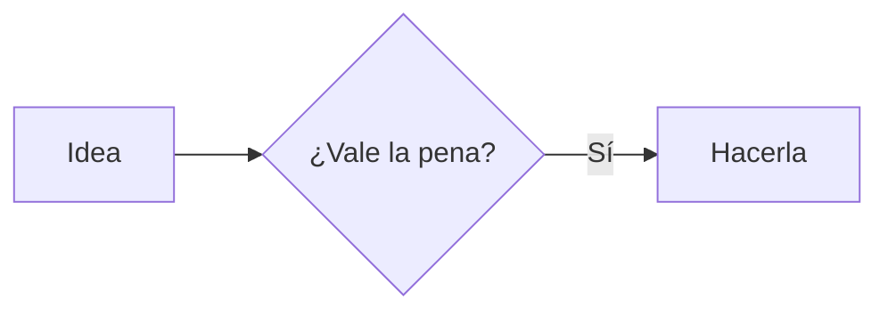

# UltimateMD

Editor de Markdown y HTML organizado en vaults, con diagramas y conexión a IA por MCP. Funciona en Linux, Windows y macOS.

Un vault es una carpeta normal con tus archivos, sin base de datos ni formato propio, así que también puedes abrir un vault de Obsidian.

## Funciones

- **Varios vaults abiertos a la vez** en una sola ventana, con pestañas de cualquiera de ellos.
- Edición, vista previa o vista dividida, con autoguardado.
- `[[wikilinks]]`, frontmatter, tablas, tareas, notas al pie e imágenes relativas.
- Selector rápido (`Ctrl+P`) y búsqueda en todos los vaults (`Ctrl+Mayús+F`).
- Archivos `.html` con vista previa, y HTML dentro de las notas.
- Diagramas Mermaid y D2, exportables a SVG y PNG.
- Siete temas que se aplican a la interfaz, el editor, la vista previa y los diagramas, con opción de seguir al sistema.
- Servidor MCP con permisos por vault.
- Los cambios externos aparecen al instante, sin sobrescribir lo que estás editando.

## Diagramas

Usa un bloque de código con el lenguaje `mermaid` o `d2`:

````markdown


```d2
direction: right
app: UltimateMD { shape: hexagon }
disco: Vaults { shape: cylinder }
app -> disco: lee y escribe
```
````

## Conectar una IA por MCP

Abre **Ajustes** en la app: allí tienes la configuración lista para copiar en Claude Code, Claude Desktop, Cursor y otros clientes. El servidor es un programa local que se comunica por stdio y **funciona aunque la app esté cerrada**.

Cada vault tiene su nivel de acceso:

| Nivel | La IA puede |
|---|---|
| Desactivado | Nada; ni siquiera ve que el vault existe |
| Lectura (por defecto) | Listar, leer, buscar y consultar enlaces |
| Lectura y escritura | Además, crear, modificar, mover y enviar a la papelera |

Herramientas: `list_vaults`, `list_notes`, `read_note`, `search_notes`, `get_backlinks`, `create_note`, `update_note`, `append_note`, `move_note` y `delete_note`.

## Seguridad

- La IA y la app solo llegan a archivos dentro del vault. Se bloquean `..`, los enlaces simbólicos que salen de él y las carpetas ocultas como `.git`, y el MCP solo accede a notas.
- Borrar siempre envía a la papelera del sistema.
- El HTML dentro de una nota se muestra sin scripts.
- Los archivos `.html` se abren en un marco aislado, sin acceso a la app ni a la red. Sus scripts están desactivados salvo que los permitas en ese vault.

## Instalación

Descarga el instalador desde [Releases](https://github.com/icabero/UltimateMD/releases).

Los instaladores aún no están firmados. En Windows, SmartScreen mostrará un aviso: pulsa **Más información → Ejecutar de todas formas**. En macOS, abre la app con clic derecho → **Abrir**.

## Desarrollo

Necesitas [Rust](https://rustup.rs), Node.js y las [dependencias de Tauri](https://tauri.app/start/prerequisites/) de tu sistema.

```sh
npm install
npm run dev          # app en modo desarrollo
npm run build        # instaladores para tu sistema
cargo test -p ultimatemd-core -p ultimatemd-mcp
npm run check
npm run test:e2e
```

| Carpeta | Contenido |
|---|---|
| `crates/core` | Vaults, archivos, búsqueda y enlaces |
| `crates/mcp` | Servidor MCP |
| `src-tauri` | Aplicación de escritorio |
| `src` | Interfaz (Svelte) |

### Ramas

El proyecto sigue gitflow:

| Rama | Sale de | Se fusiona en | Uso |
|---|---|---|---|
| `main` | | | Versiones publicadas |
| `develop` | `main` | | Integración del siguiente trabajo |
| `feature/*` | `develop` | `develop` | Funciones y mejoras |
| `release/x.y.z` | `develop` | `main` y `develop` | Preparar una versión |
| `hotfix/x.y.z` | `main` | `main` y `develop` | Arreglos urgentes en una versión publicada |

Al fusionar una `release/*` o `hotfix/*` en `main`, etiqueta ese commit como `vx.y.z`. La etiqueta hace que GitHub Actions compile todos los instaladores y cree un borrador de release.

## Licencia

MIT
