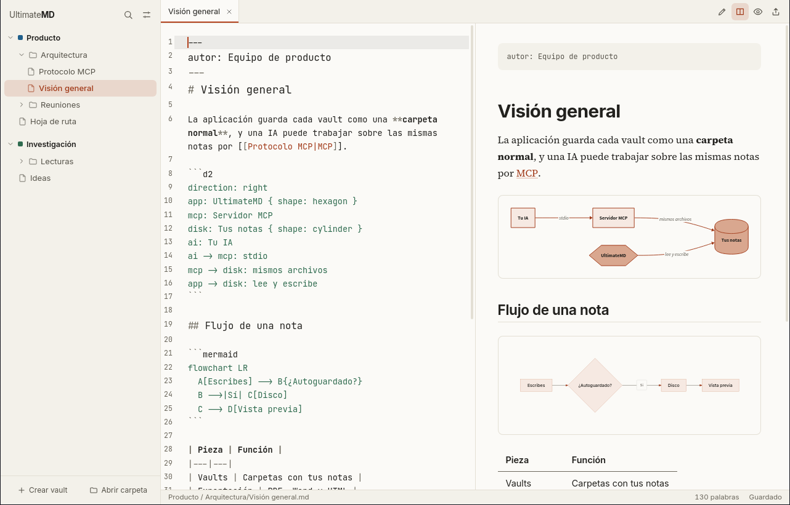
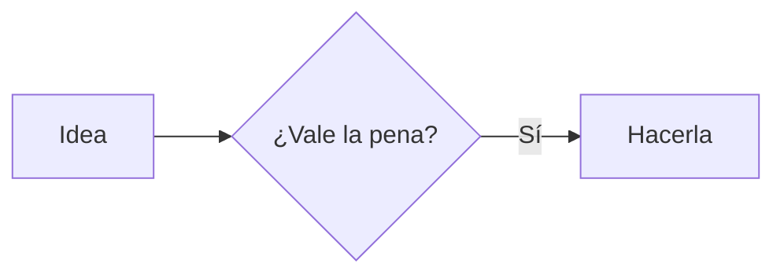

<p align="center"></p>
<h1 align="center">UltimateMD</h1>
<p align="center">Tus notas en Markdown, convertidas en documentos de verdad.</p>
<p align="center">
  <a href="https://icabero.github.io/UltimateMD/"><strong>Web</strong></a> ·
  <a href="https://github.com/icabero/UltimateMD/releases/latest"><strong>Descargar</strong></a> ·
  <a href="https://github.com/icabero/UltimateMD/issues">Issues</a>
</p>
<p align="center">
  <a href="https://github.com/icabero/UltimateMD/actions/workflows/ci.yml"></a>
  <a href="LICENSE"></a>
</p>



UltimateMD es un editor libre para Windows, macOS y Linux. Tus notas siguen siendo archivos `.md` en carpetas normales, sin base de datos ni formato propio, así que también puedes abrir un vault de Obsidian tal cual.

## Qué puedes hacer

- **Trabajar con varios vaults a la vez**, en una sola ventana, con pestañas de cualquiera de ellos.
- **Editar** con vista dividida, autoguardado, `[[wikilinks]]`, búsqueda global y selector rápido.
- **Dibujar diagramas** Mermaid y D2 dentro de la nota, sin conexión.
- **Exportar** una nota, una carpeta o un vault a PDF, Word o HTML, con vista previa.
- **Usar tus plantillas de Word**, conservando portada, cabeceras, estilos e índice.
- **Conectar tu IA** por MCP, con permisos por vault.
- **Personalizarla** con siete temas y temas propios por vault, nota o diagrama.
- **Abrir `.md` sueltos** y usarla como programa por defecto.

## Instalación

Descarga el instalador de tu sistema desde [Releases](https://github.com/icabero/UltimateMD/releases/latest).

| Sistema | Archivo |
|---|---|
| Windows | `.exe` o `.msi` |
| macOS | `.dmg`, para Apple Silicon o Intel |
| Linux | AppImage, `.deb` o `.rpm` |

Los instaladores aún no están firmados:

- **Windows:** en el aviso de SmartScreen, pulsa **Más información → Ejecutar de todas formas**.
- **macOS:** abre la app con clic derecho → **Abrir**.

### Programa por defecto

- **Windows:** en Ajustes, abre las aplicaciones predeterminadas y elige UltimateMD para `.md`. Windows no permite que una app se asigne sola.
- **macOS:** en el Finder, abre la información de un `.md`, elige UltimateMD en "Abrir con" y pulsa "Cambiar todo".
- **Linux:** con el paquete `.deb` o `.rpm`, usa el botón de Ajustes. Un AppImage no se integra en el sistema.

## Conectar una IA por MCP

Abre **Ajustes** en la app: allí tienes la configuración lista para copiar en Claude Code, Claude Desktop, Cursor y otros clientes. El servidor es un programa local que se comunica por stdio y **funciona aunque la app esté cerrada**. Si está abierta, ves los cambios al momento.

| Nivel de acceso | La IA puede |
|---|---|
| Desactivado | Nada; ni siquiera ve que el vault existe |
| Lectura (por defecto) | Listar, leer, buscar y consultar enlaces |
| Lectura y escritura | Además, crear, modificar, mover y enviar a la papelera |

Herramientas: `list_vaults`, `list_notes`, `read_note`, `search_notes`, `get_backlinks`, `create_note`, `update_note`, `append_note`, `move_note` y `delete_note`.

## Exportar


Pulsa `Ctrl+E`. Lo exportado usa siempre un aspecto de documento, sea cual sea el tema activo.

- **Alcance:** la nota, una carpeta o el vault. Las notas salen en orden natural: primero las de cada carpeta y luego sus subcarpetas. Usa prefijos como `01-` para fijar el orden.
- **Carpetas:** cada nivel puede ser un título, un estilo de tu plantilla o no aparecer, con salto de página opcional. Los títulos de las notas bajan de nivel para encajar.
- **PDF:** se compone directamente con un motor tipográfico integrado, sin diálogo de impresión, con portada e índice opcionales.
- **Word:** la nota se escribe dentro de una copia de tu plantilla. Incluye una plantilla de ejemplo que puedes guardar y adaptar.

Marcadores para tu plantilla:

| Marcador | Se sustituye por |
|---|---|
| `{{contenido}}` | El texto. Sin este marcador, va al final del documento |
| `{{titulo}}` | El título del frontmatter, el primer encabezado o el nombre del archivo o carpeta |
| `{{autor}}`, `{{fecha}}` | Esos datos del frontmatter. La fecha, si falta, es la de hoy |
| `{{cualquier-dato}}` | Ese campo del frontmatter |

Al abrir el documento, Word pregunta si quieres actualizar los campos: acepta para que el índice muestre las páginas.

## Diagramas

Usa un bloque de código con el lenguaje `mermaid` o `d2`:

````markdown


```d2
direction: right
app: UltimateMD { shape: hexagon }
disco: Vaults { shape: cylinder }
app -> disco: lee y escribe
```
````

## Temas


Cada vault puede tener temas propios, creados desde **Ajustes → Temas**. Se guardan en `.ultimatemd/temas/` y viajan con él. Gana la capa más específica: nota, vault y aplicación. La interfaz sigue siempre el tema de la aplicación.

```yaml
---
tema: corporativo
tema-diagramas: boceto
---
```

`tema-diagramas` elige otro tema solo para los diagramas, o `boceto` para un aspecto dibujado a mano.

## Seguridad

- La IA y la app solo llegan a archivos dentro del vault. Se bloquean `..`, los enlaces simbólicos que salen de él y las carpetas ocultas como `.git`. El MCP solo accede a notas.
- Borrar siempre envía a la papelera del sistema.
- El HTML dentro de una nota se muestra sin scripts. Los archivos `.html` se abren en un marco aislado, sin acceso a la app ni a la red, y sus scripts van desactivados salvo que los permitas en ese vault.
- Un archivo suelto solo da acceso a ese archivo y a las imágenes de su carpeta.
- Los temas son datos validados, sin CSS, y una nota nunca se ejecuta como código al exportar.

## Desarrollo

Necesitas [Rust](https://rustup.rs), Node.js y las [dependencias de Tauri](https://tauri.app/start/prerequisites/) de tu sistema.

```sh
npm install
npm run dev          # app en modo desarrollo
npm run build        # instaladores para tu sistema
cargo test -p ultimatemd-core -p ultimatemd-mcp -p ultimatemd-pdf
npm run check
npm run test:e2e
```

| Carpeta | Contenido |
|---|---|
| `crates/core` | Vaults, archivos, búsqueda, enlaces, temas y Word |
| `crates/mcp` | Servidor MCP |
| `crates/pdf` | Generación de PDF con Typst |
| `src-tauri` | Aplicación de escritorio |
| `src` | Interfaz (Svelte) |
| `site` | Web del proyecto |

El proyecto sigue gitflow:

| Rama | Sale de | Se fusiona en | Uso |
|---|---|---|---|
| `main` | | | Versiones publicadas |
| `develop` | `main` | | Integración del siguiente trabajo |
| `feature/*` | `develop` | `develop` | Funciones y mejoras |
| `release/x.y.z` | `develop` | `main` y `develop` | Preparar una versión |
| `hotfix/x.y.z` | `main` | `main` y `develop` | Arreglos urgentes en una versión publicada |

Al fusionar una `release/*` o `hotfix/*` en `main`, etiqueta ese commit como `vx.y.z`. La etiqueta hace que GitHub Actions compile todos los instaladores y cree un borrador de versión.

## Licencia

[MIT](LICENSE)
