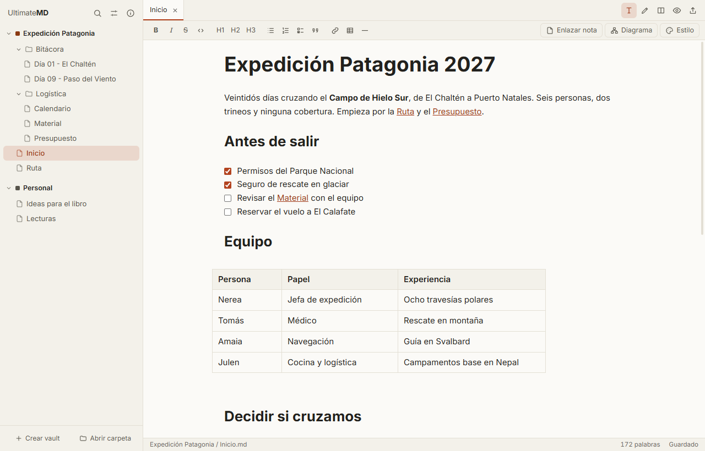
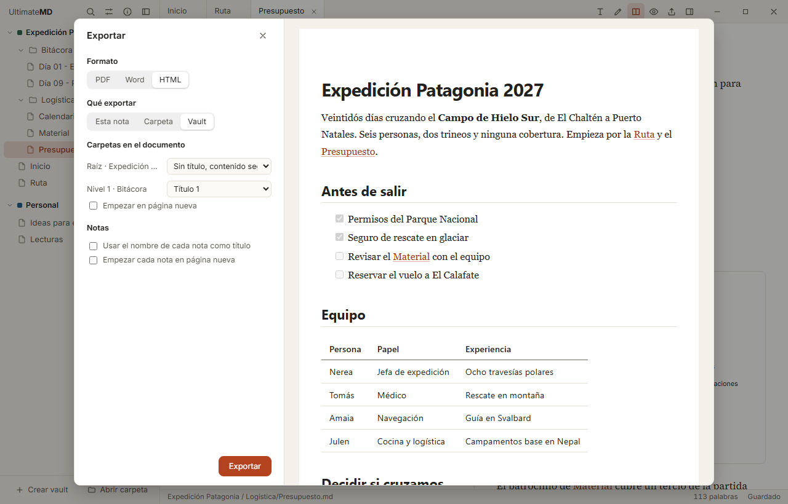
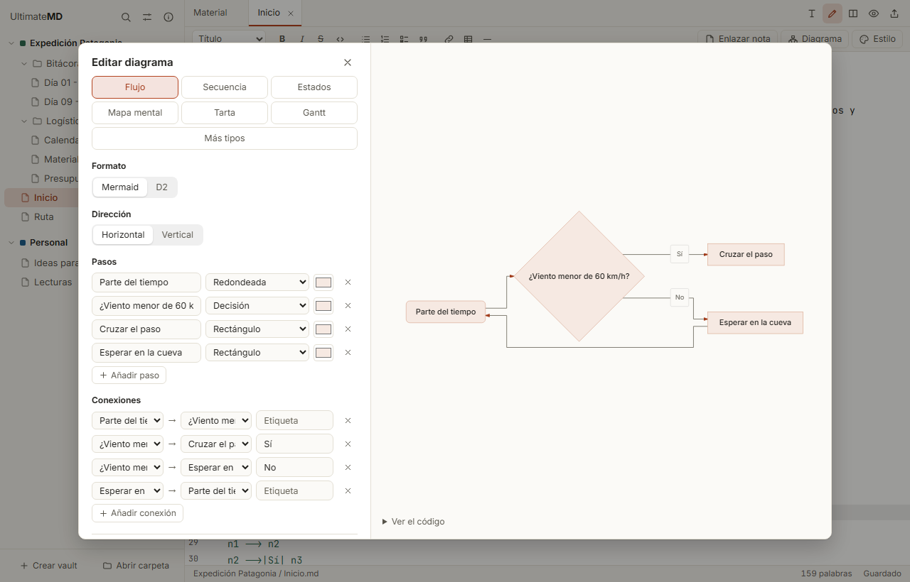
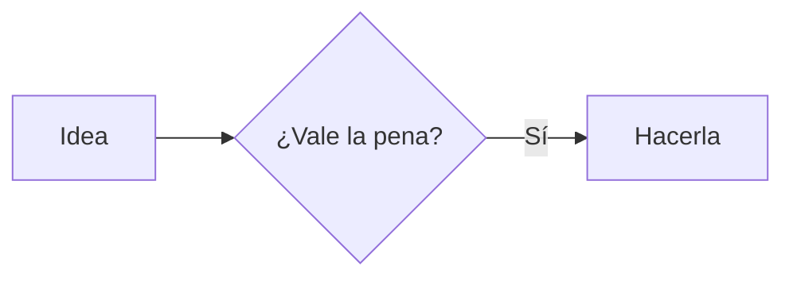
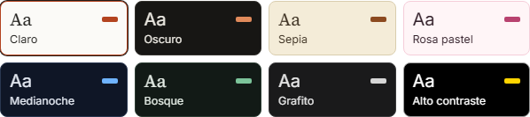
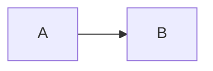

<p align="center"></p>
<h1 align="center">UltimateMD</h1>
<p align="center">Tus notas en Markdown, convertidas en documentos de verdad.</p>
<p align="center">
  <a href="https://icabero.github.io/UltimateMD/"><strong>Web</strong></a> ·
  <a href="https://github.com/icabero/UltimateMD/releases/latest"><strong>Descargar</strong></a> ·
  <a href="https://github.com/icabero/UltimateMD/issues">Issues</a>
</p>
<p align="center">
  <a href="https://github.com/icabero/UltimateMD/actions/workflows/ci.yml"></a>
  <a href="LICENSE"></a>
</p>



**[Visita la web de UltimateMD](https://icabero.github.io/UltimateMD/)** para ver qué puede hacer y descargarla.

UltimateMD es un editor libre para Windows, macOS y Linux. Tus notas siguen siendo archivos `.md` en carpetas normales, sin base de datos ni formato propio, así que también puedes abrir un vault de Obsidian tal cual.

## Qué puedes hacer

- **Trabajar con varios vaults a la vez**, en una sola ventana, con pestañas de cualquiera de ellos.
- **Editar en modo visual**, con formato mientras escribes y barra de herramientas, o en Markdown con vista dividida. El archivo siempre sigue siendo Markdown normal.
- **Escribir más rápido**: pega desde webs, Word o Google Docs y se convierte en Markdown; pega o arrastra imágenes y se guardan en el vault; crea notas desde plantillas; usa callouts como `> [!warning]`.
- **Enlazar notas** escribiendo `[[` o con un botón, con sugerencias y un clic para abrirlas, también a un título (`[[nota#Título]]`). Al renombrar o mover una nota, sus enlaces se actualizan solos, y una pantalla reúne los enlaces rotos del vault para corregirlos.
- **Moverte rápido** con autoguardado, selector rápido y búsqueda global que no distingue acentos y abre la nota en la línea encontrada.
- **Dibujar diagramas** Mermaid y D2 dentro de la nota, sin conexión: con un creador visual para los más habituales, plantillas para todos los demás y conexiones animadas. Si uno falla, te dice en qué línea y por qué.
- **Exportar** una nota, una carpeta o un vault a PDF, Word o HTML en tres pasos, con vista previa y una revisión que avisa de lo que saldría mal.
- **Usar tus plantillas de Word**, conservando portada, cabeceras, estilos e índice.
- **Conectar tu IA** por MCP, con permisos por vault.
- **Personalizarla** con ocho temas y temas propios por vault, nota o diagrama, y ajustar el tamaño del texto y el ancho de línea.
- **Abrir `.md` sueltos** y usarla como programa por defecto.
- **Usarla en castellano, euskera o inglés**, con un tutorial la primera vez y aviso de nuevas versiones.

## Instalación

Descarga el instalador de tu sistema desde [Releases](https://github.com/icabero/UltimateMD/releases/latest).

| Sistema | Archivo |
|---|---|
| Windows | `.exe`, que deja elegir idioma, `.msi` o el `.zip` portable |
| macOS | `.dmg`, para Apple Silicon o Intel |
| Linux | AppImage, `.deb` o `.rpm` |

La **versión portable** no se instala: descomprime el `.zip` donde quieras, por ejemplo en un USB, y abre `UltimateMD.exe`. Guarda la lista de vaults, los ajustes y el historial en la carpeta `datos` que crea a su lado, y no deja nada en el equipo. Para actualizarla, sustituye los archivos del programa por los del zip nuevo.

Los instaladores aún no están firmados:

- **Windows:** en el aviso de SmartScreen, pulsa **Más información → Ejecutar de todas formas**.
- **macOS:** abre la app con clic derecho → **Abrir**.

### Programa por defecto

- **Windows:** en Ajustes, abre las aplicaciones predeterminadas y elige UltimateMD para `.md`. Windows no permite que una app se asigne sola.
- **macOS:** en el Finder, abre la información de un `.md`, elige UltimateMD en "Abrir con" y pulsa "Cambiar todo".
- **Linux:** con el paquete `.deb` o `.rpm`, usa el botón de Ajustes. Un AppImage no se integra en el sistema.

## Conectar una IA por MCP

Abre **Ajustes → Inteligencia artificial** en la app: allí tienes la configuración lista para copiar en Claude Code, Claude Desktop, Cursor y otros clientes. El servidor es un programa local que se comunica por stdio y **funciona aunque la app esté cerrada**. Si está abierta, ves los cambios al momento.

| Nivel de acceso | La IA puede |
|---|---|
| Desactivado | Nada; ni siquiera ve que el vault existe |
| Lectura (por defecto) | Listar, leer, buscar y consultar enlaces |
| Lectura y escritura | Además, crear, modificar, mover y enviar a la papelera |

Herramientas: `list_vaults`, `list_notes`, `read_note`, `search_notes`, `get_backlinks`, `get_outline`, `read_section`, `list_tags`, `get_diagram_guide`, `create_note`, `update_note`, `append_note`, `insert_at_heading`, `add_diagram_image`, `move_note` y `delete_note`. La IA puede leer y escribir una sección de una nota sin reescribirla entera.

### Diagramas de la IA con el estilo del vault

Para que todos los diagramas de un vault se parezcan, los dibuje quien los dibuje, el vault puede llevar una **guía de estilo**, como un `CLAUDE.md` para diagramas. Ábrela con clic derecho en el vault → **Estilo de diagramas para la IA**. Puedes escribirla a mano o pulsar **Partir del estilo actual** para empezar con los colores y la forma con que la app dibuja ya los diagramas del vault. Se guarda en `.ultimatemd/diagramas.md` y viaja con el vault.

- Antes de dibujar, la IA lee la guía con `get_diagram_guide`. La usa tanto si dibuja en Mermaid o D2 como si hace una imagen.
- Cuando Mermaid o D2 no bastan, la IA guarda el diagrama como imagen con `add_diagram_image`. Puede ser un SVG, que se limpia antes de guardarlo (sin scripts ni nada que se cargue de fuera), o un PNG. La imagen va a `adjuntos/` y se inserta en la nota o en una sección.
- Una nota puede añadir algo propio con `diagramas:` en sus propiedades: un texto corto o un `[[enlace]]` a otra nota que haga de guía.
- Clic derecho sobre una imagen que dibujó la IA → **Copiar petición para volver a dibujarlo**, para pegarla en tu asistente.

## Exportar



Pulsa `Ctrl+E` y sigue los pasos **Formato**, **Contenido** y **Aspecto**. El diálogo recuerda tus últimas opciones en cada vault, así que puedes pulsar **Exportar** desde cualquier paso. Al terminar, puedes abrir el documento o mostrarlo en su carpeta.

Lo exportado usa un aspecto de documento, sea cual sea el tema activo. Los diagramas conservan el estilo que les hayas dado, salvo los temas oscuros, pensados para pantalla y no para papel.

- **Antes de exportar:** se revisan las notas y se avisa de imágenes que faltan, enlaces que no llevan a ninguna parte, diagramas que no se pueden dibujar y títulos que saltan niveles. Cada aviso lleva a su línea; también puedes exportar así.

- **Alcance:** la nota, una carpeta o el vault. Las notas salen en orden natural: primero las de cada carpeta y luego sus subcarpetas. Usa prefijos como `01-` para fijar el orden.
- **Carpetas:** cada nivel puede ser un título, un estilo de tu plantilla o no aparecer, con salto de página opcional. Los títulos de las notas bajan de nivel para encajar.
- **Enlaces entre notas:** en Word y PDF, un `[[enlace]]` a una nota o a un título que va en el mismo documento salta a ese punto y muestra su título, no el nombre del archivo. Las notas no cambian.
- **PDF:** se compone directamente con un motor tipográfico integrado, sin diálogo de impresión, con portada e índice opcionales. Lleva el título y el `autor` del frontmatter en sus propiedades, y puede generarse como PDF/A para archivar.
- **Word:** la nota se escribe dentro de una copia de tu plantilla. Incluye una plantilla de ejemplo que puedes guardar y adaptar.
- **Word por vault:** cada vault puede llevar su propia plantilla y ajustar títulos, texto, tablas, imágenes y código, con una muestra en directo. Se abre desde el icono de Word junto al nombre del vault. Los estilos de títulos numerados de la plantilla se detectan solos.

Marcadores para tu plantilla:

| Marcador | Se sustituye por |
|---|---|
| `{{contenido}}` | El texto. Sin este marcador, va al final del documento |
| `{{titulo}}` | El título del frontmatter, el primer encabezado o el nombre del archivo o carpeta |
| `{{autor}}`, `{{fecha}}` | Esos datos del frontmatter. La fecha, si falta, es la de hoy |
| `{{cualquier-dato}}` | Ese campo del frontmatter |

Si el documento tiene índice, pulsa sobre él y luego `F9` en Word para que muestre los números de página.

## Vaults de Obsidian

Abre la carpeta del vault como cualquier otra. UltimateMD no toca `.obsidian` ni `.trash`, que no salen en el árbol, así que puedes seguir usando los dos programas con el mismo vault.

| Funciona | Cómo |
|---|---|
| `[[enlaces]]`, `[[nota\|texto]]`, `[[carpeta/nota]]` | Se abren con un clic y se actualizan al renombrar o mover |
| `[[nota#Título]]` y `[[nota#^bloque]]` | Abren la nota; el título, además, salta a su sitio |
| `![[imagen.png]]` | Se muestra, la busque donde la busque Obsidian |
| Etiquetas `#etiqueta`, `#anidada/etiqueta` y `tags:` del frontmatter | Se cuentan, se sugieren y se buscan |
| Callouts `> [!tipo]`, también plegables con `-` y `+` | Con su color e icono |
| `==resaltado==` y `%%comentarios%%` | El comentario no se ve ni sale al exportar. En Word y PDF el resaltado queda como texto normal |
| Tareas `- [ ]` y `- [x]` | Se marcan con un clic en el modo visual |

| Aún no | Qué pasa |
|---|---|
| `aliases:` del frontmatter | Un enlace escrito con el alias sale como roto |
| `![[otra nota]]` y `![[nota#Título]]` | Se muestra como enlace, no con el texto de la otra nota |
| Bloques `dataview` y archivos `.canvas` | El bloque se ve como código y el lienzo no se abre |

## Diagramas



Pulsa **Diagrama** en la barra del editor y créalo con un formulario, viendo el resultado al momento. Hay formularios para flujos, secuencias, estados, mapas mentales, tartas y Gantt; flujos y secuencias pueden guardarse en Mermaid o D2.

**Más tipos** ofrece una plantilla editable para el resto: clases, entidad-relación, líneas de tiempo, Kanban, barras, Sankey, arquitectura y otros, además de tablas de base de datos y rejillas en D2.

En modo visual, pulsa sobre un diagrama para abrirlo. También puedes escribirlo a mano con un bloque `mermaid` o `d2`:

````markdown


```d2
direction: right
app: UltimateMD { shape: hexagon }
disco: Vaults { shape: cylinder }
app -> disco: lee y escribe
```
````

## Temas



Cada vault puede tener temas propios, creados desde **Ajustes → Vaults → Temas**. Se guardan en `.ultimatemd/temas/` y viajan con él. Gana la capa más específica: nota, vault y aplicación. La interfaz sigue siempre el tema de la aplicación.

Los diagramas tienen su propio estilo, que eliges con el botón **Estilo** de la barra para toda la nota o todo el vault. Un diagrama concreto puede ir por libre desde **Apariencia de este diagrama**, con su tema, sus colores o un aspecto de boceto a mano.

Todo queda en tus archivos, por si prefieres escribirlo a mano:

```yaml
---
tema: corporativo
tema-diagramas: boceto
---
```

````markdown

````

## Privacidad y seguridad

- Tus notas no salen de tu equipo. La app solo se conecta a internet para preguntar a GitHub si hay una versión nueva; puedes desactivarlo en **Acerca de**.
- La IA y la app solo llegan a archivos dentro del vault. Se bloquean `..`, los enlaces simbólicos que salen de él y las carpetas ocultas como `.git`. El MCP solo accede a notas.
- Borrar siempre envía a la papelera del sistema.
- El HTML dentro de una nota se muestra sin scripts. Los archivos `.html` se abren en un marco aislado, sin acceso a la app ni a la red, y sus scripts van desactivados salvo que los permitas en ese vault.
- Un archivo suelto solo da acceso a ese archivo y a las imágenes de su carpeta.
- Los temas son datos validados, sin CSS, y una nota nunca se ejecuta como código al exportar.

## Compilar desde el código

Necesitas [Rust](https://rustup.rs), Node.js y las [dependencias de Tauri](https://tauri.app/start/prerequisites/) de tu sistema.

```sh
npm install
npm run dev     # abre la app
npm run build   # crea los instaladores para tu sistema
```

Los espacios, radios, tamaños de letra, sombras y capas de la interfaz siguen el [sistema de diseño](docs/sistema-de-diseno.md); `npm run lint` avisa si se escribe un valor suelto.

Las capturas de `site/img` salen de la interfaz real, con un vault de ejemplo inventado: `npm run screenshots` las vuelve a generar.

## Contribuir

El código es abierto y puedes usarlo, estudiarlo o adaptarlo con su licencia. El desarrollo es privado por ahora: no se aceptan pull requests sin acuerdo previo. Si encuentras un fallo o tienes una idea, abre una [issue](https://github.com/icabero/UltimateMD/issues). Para avisar de un problema de seguridad, sigue la [política de seguridad](SECURITY.md).

## Licencia

[MIT](LICENSE)
